<p align="center">
  
</p>

<h1 align="center">CANary</h1>

<p align="center">The canary in the coal mine for your engine.<br>Open firmware for the MeatPi WiCAN Pro that watches a car's health on every drive, keeps its odometer up to date in <a href="https://github.com/au12/glovebox">Glovebox</a> and turns what it records into a weekly report.</p>

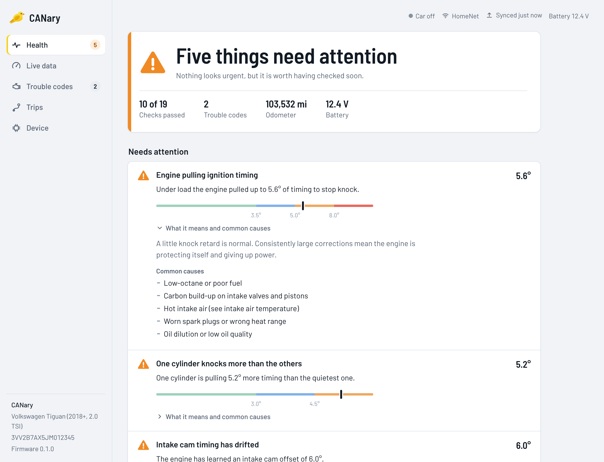

<table>
  <tr>
    <td width="25%">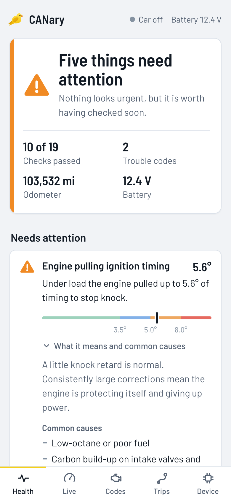</td>
    <td width="25%">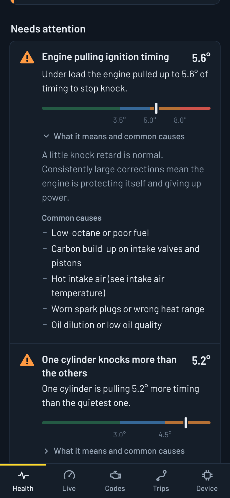</td>
    <td width="25%">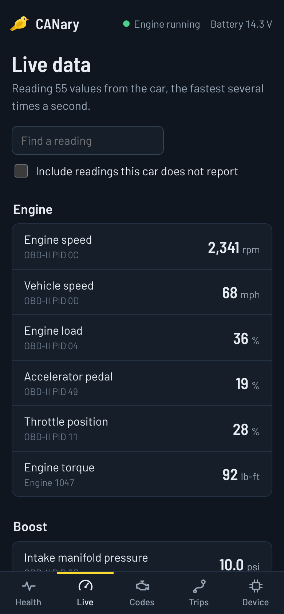</td>
    <td width="25%">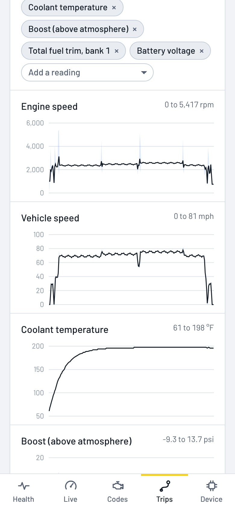</td>
  </tr>
</table>

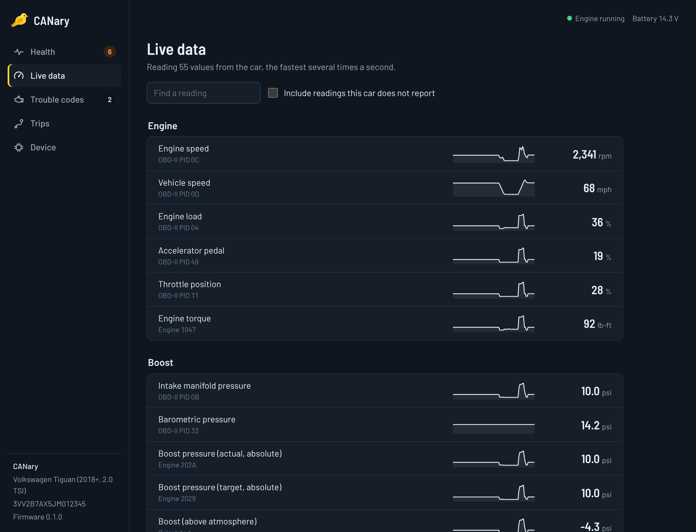

> **Where this stands.** Version 0.1.1 is the first public build. Everything here runs and is tested against a simulated car, and the firmware builds for the WiCAN Pro, but it has not yet completed its first drive in a real one. The standard OBD-II readings follow the published standard. The Volkswagen-specific ones come from a community database and still have to be confirmed on the car. Expect rough edges, and see [what is tested and what is not](#what-is-tested-and-what-is-not).

## What it does

Most engine problems show up in the data long before a warning light does: boost that no longer reaches its target, fuel trims creeping up, one cylinder pulling timing, cam timing drifting. A scan tool shows those numbers if you know to look. CANary looks on every drive and tells you in plain language.

- **Health checks while you drive.** Each check watches one thing under the conditions where it means something (boost only under hard acceleration, fuel trim only on a warm engine) and needs enough of those conditions before it gives a verdict. Findings are ordered by severity, and each one shows where the reading sits against its limits, what it means and the usual causes.
- **Trouble codes from every control unit** the car's profile covers, not only the engine: stored, pending and permanent, with a plain description.
- **Live data.** Every reading the car reports, grouped, with a short history beside each.
- **Every drive recorded** to the SD card: all readings, as fast as the car answers. Open a drive on the device to chart any of them.
- **Glovebox keeps the long view.** Whenever the car is back on your Wi-Fi the device sends the odometer reading and uploads the drives recorded since last time. Glovebox analyses them again itself and builds a weekly report with trends. A week after a drive is safely uploaded, the device frees the space.
- **Its own web page, no app and no cloud.** Open `http://canary.local` from a phone or a computer. Nothing leaves your network.
- **Looks after the car.** It only ever reads, goes quiet when the car does, and sleeps when parked.

## What it checks

Thirteen checks need nothing but standard OBD-II and run on any car that reports the readings they use. Eight more come with the Volkswagen EA888 profile. A check a car cannot support is listed as not available rather than guessed at.

| | Checks |
| --- | --- |
| **Boost** | Boost below target (leaks, diverter valve, wastegate), boost above target, intake air much hotter than outside (intercooler) |
| **Fuel mixture** | Lean or rich at idle (vacuum leaks, injectors), lean or rich under load (fuel delivery), banks that disagree |
| **Ignition** | Knock retard under load, one cylinder knocking more than the rest, misfire counts per cylinder |
| **Valve timing** | Learned cam offsets on the intake and exhaust side (how a stretching timing chain shows up on earlier EA888 engines; see the note in [the reference](docs/checks.md#intake-cam-adaptation)), cam timing not following its target |
| **Fuel delivery** | High-pressure rail below target, low-side pressure low |
| **Cooling and oil** | Running hot, slow to warm up (thermostat), oil temperature |
| **Electrical** | Charging voltage low, charging voltage too high |
| **Exhaust and self-tests** | Catalyst temperature, trouble codes cleared recently |

Every limit, the driving conditions each check waits for and where the numbers come from are in [docs/checks.md](docs/checks.md).

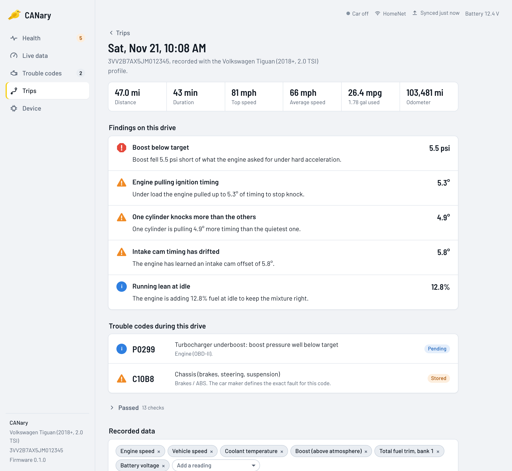

## The weekly report in Glovebox

The device judges one drive at a time. [Glovebox](https://github.com/au12/glovebox) (a self-hosted vehicle maintenance tracker, on its `CANary` branch for now) keeps every drive and looks at the week: a verdict in plain words, what is new or getting worse, each finding against its limits with a trend over the past weeks, and every drive by day with the raw recording behind it. It prints as a report you can hand to a mechanic.

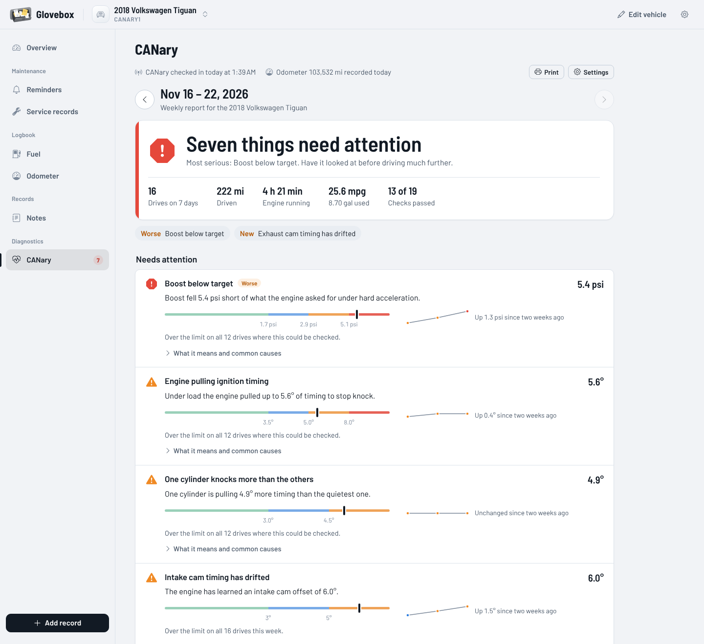

<table>
  <tr>
    <td width="24%">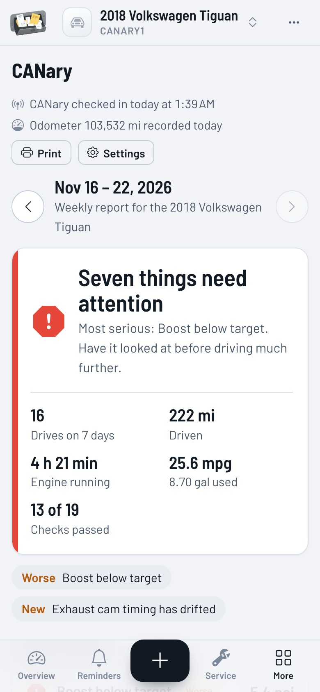</td>
    <td width="24%">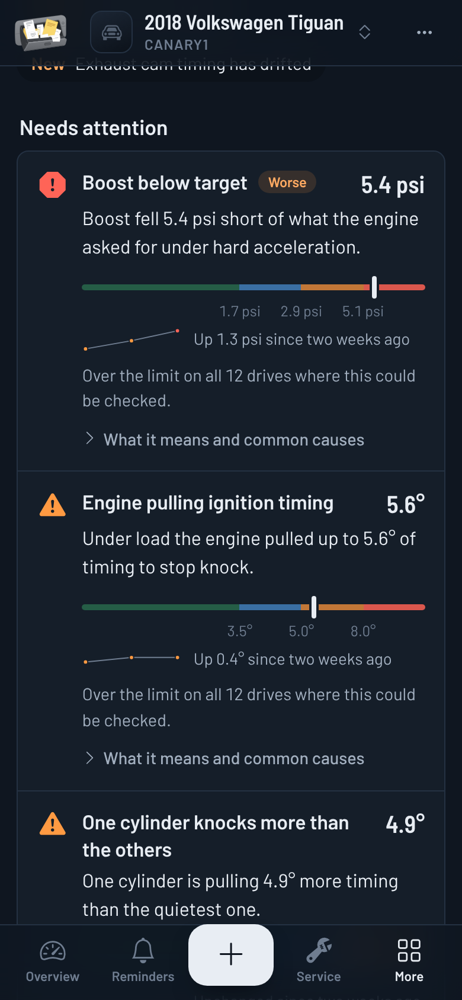</td>
    <td width="52%">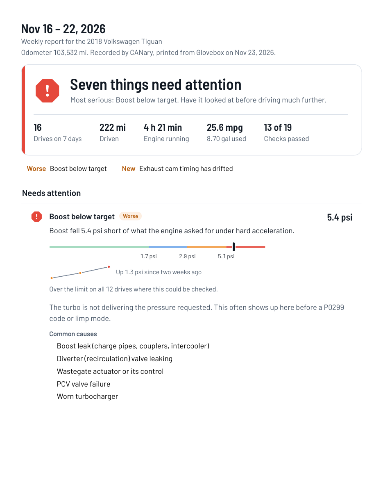</td>
  </tr>
</table>

Without Glovebox the device still does everything on its own page. Pointed at a plain [LubeLogger](https://github.com/hargata/lubelog) server it keeps the odometer records up to date and leaves it at that.

## Supported cars

| Profile | Covers | Status |
| --- | --- | --- |
| Generic OBD-II | Any car with OBD-II over CAN: every car sold in the US since model year 2008, and most European cars from the mid-2000s on. The car is asked which standard readings it supports. | Follows SAE J1979. Tested against the simulator. |
| Volkswagen Tiguan (2018+, 2.0 TSI) | Everything above, plus EA888 Gen 3 engine readings (per-cylinder knock and misfires, cam adaptation, rail and low-side fuel pressure, boost target), the instrument cluster's odometer and trouble codes from nine control units. Chosen automatically from the VIN. | The development car. Identifiers from the OBDb community database; on-car confirmation in progress. |
| Other Volkswagen, Audi, Škoda and SEAT on the MQB platform | Control-unit addresses, odometer and trouble codes from the shared MQB profile, with generic engine checks. | Untested. |

A car is described by a profile: a JSON file that lists what to ask for, how to decode the answer and what to check. Profiles build on each other, so a new model usually needs a few lines. See [docs/profiles.md](docs/profiles.md).

## What you need

- A MeatPi WiCAN Pro (the OBD-II adapter behind the open [wican-fw](https://github.com/meatpiHQ/wican-fw) project). The older WiCAN with the ESP32-C3 is not supported: it has neither the memory nor the SD card slot.
- A microSD card. Any size from 4 GB; a 32 GB card holds years of driving. Without one the checks still run, but nothing is recorded and nothing can be uploaded.
- Wi-Fi that reaches where the car is parked, if you want the Glovebox side.

There is also an experimental build for a bare ESP32-S3 board with a CAN transceiver. See [docs/hardware.md](docs/hardware.md).

## Install

1. Download `canary-wican-pro-<version>.bin` from the [latest release](https://github.com/au12/CANary/releases).
2. Plug the WiCAN Pro into the car, join its Wi-Fi network and open its configuration page.
3. On the **System** tab, under **Firmware Update**, choose the file and click **Update**.
4. After about a minute the device restarts as CANary. Join the network `CANary-XXXX` (password `canary-setup`) and open `http://192.168.4.1`.
5. Under **Device**, add your home Wi-Fi. From then on the page is at `http://canary.local` whenever the car is home.

CANary uses the same flash layout as the stock firmware, so you can go back the same way: upload MeatPi's firmware file under **Device > System** on CANary's page. Flashing over USB, recovery mode and what the button and the light do are covered in [docs/install.md](docs/install.md).

## Connecting Glovebox

1. Run the `canary` image of Glovebox (`ghcr.io/au12/glovebox:canary`).
2. Open the vehicle in Glovebox and choose **CANary**. The page shows three values: the server's address, the vehicle number and, if your Glovebox has a login, a button that creates an API key.
3. Enter them on the device under **Device > Glovebox** and save.

The device checks in within a minute, and again every time it joins Wi-Fi.

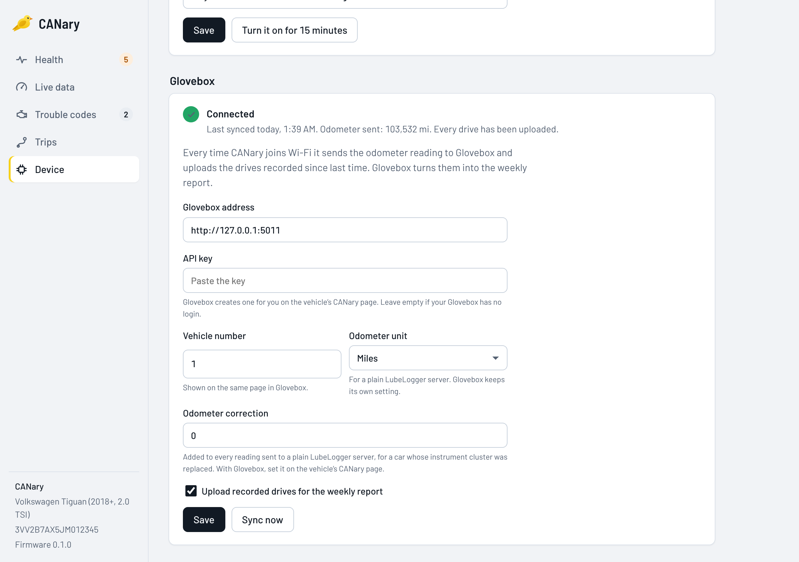

## It only reads

The diagnostic port can do more than read: it can clear codes, run actuators and reprogram control units. CANary's lowest layer refuses every request that is not on a short list of read-only services, so no profile, no setting and no bug above it can send anything else. It also keeps to itself:

- When the car stops answering, CANary stops asking. It does not probe a sleeping car.
- With the ignition on and the engine off it polls for three minutes, drops to a heartbeat, and is silent after fifteen, so it never keeps control units awake.
- Parked, it finishes uploading, then sleeps until the battery voltage shows the engine has started.

The details are in [docs/how-it-works.md](docs/how-it-works.md).

## What is tested and what is not

Tested, on every change:

- The whole engine (bus protocol, polling, checks, trip recording, upload, power decisions) runs unmodified on a desktop against a simulated car, with more than 400 automated checks over whole simulated drives.
- The web interface, by a scripted browser clicking through every page.
- The full path from device to Glovebox: a simulated fortnight of driving uploaded over the real protocol, analysed by the server and compared with the device's own verdicts.
- The firmware builds for the WiCAN Pro without warnings.

Not yet:

- **A real car.** The first on-car trial is the next step. Until then, treat the Volkswagen-specific readings and their scaling as unconfirmed.
- **The hardware drivers on the device itself:** SD card, clock, status light, sleep and wake. They follow MeatPi's published pin map and schematic.
- **Current draw while asleep.** Not measured. If the car will stand for weeks, unplug the device until this is known.

If you try it, **Device > Advanced** has a file that records what the car answered. [Open an issue](https://github.com/au12/CANary/issues) and attach it.

## Documentation

| | |
| --- | --- |
| [Install and first setup](docs/install.md) | Flashing, the button and the light, updating, going back to stock, recovery |
| [How it works](docs/how-it-works.md) | Talking to the car, checks, drives, syncing, sleep |
| [Checks](docs/checks.md) | Every check, its conditions and limits |
| [Vehicle profiles](docs/profiles.md) | Adding a car or a check |
| [Log format](docs/log-format.md) | The raw recording of a drive |
| [Device API](docs/device-api.md) | What the web page uses, for your own tools |
| [Server protocol](docs/server-protocol.md) | What the device sends to Glovebox |
| [Hardware](docs/hardware.md) | WiCAN Pro pin map, other boards |
| [Development](docs/development.md) | Building, the simulator, tests, releases |
| [Roadmap](ROADMAP.md) | What comes next |

## Try it without a car

The simulator runs the real engine and the real web page against a modelled turbo petrol engine with faults you choose:

```
cmake -S host -B build-host -G Ninja && cmake --build build-host
build-host/canary-sim --scenario worn --days 14 --wear 2.5
```

Then open `http://localhost:8088`. `--scenario healthy` shows a car with nothing wrong.

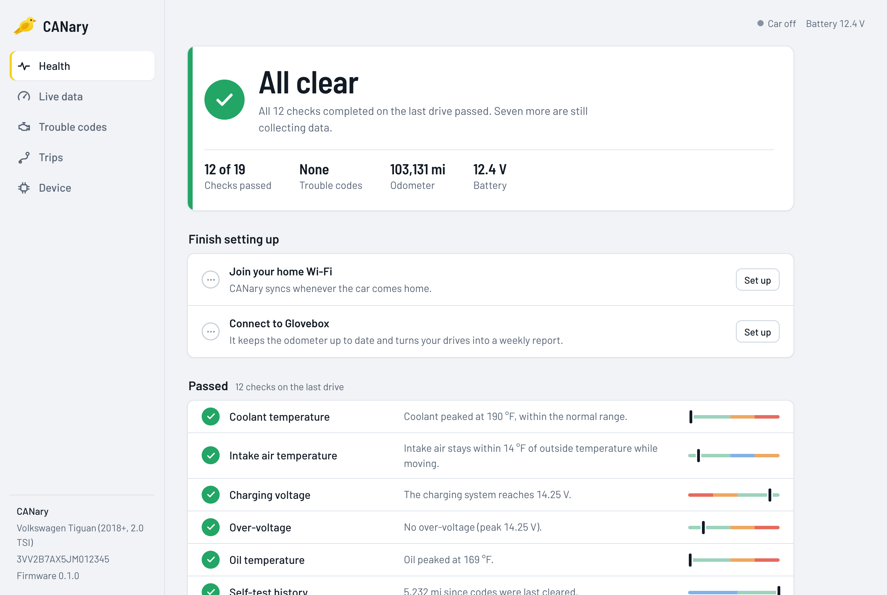

## License and credits

CANary is free software under the [GNU General Public License v3.0](LICENSE) or later.

- Board support for the WiCAN Pro follows the pin map and schematic of MeatPi's [wican-fw](https://github.com/meatpiHQ/wican-fw) (GPL-3.0). CANary is an independent firmware and is not affiliated with or supported by MeatPi.
- Volkswagen identifiers and scalings come from the [OBDb](https://github.com/OBDb) community database (CC BY-SA 4.0).
- The interface is set in [Barlow](https://github.com/jpt/barlow) (SIL Open Font License).
- Built on [ESP-IDF](https://github.com/espressif/esp-idf) (Apache-2.0) and [cJSON](https://github.com/DaveGamble/cJSON) (MIT).

Full notices are in [THIRD-PARTY.md](THIRD-PARTY.md).

CANary is a hobby project. It reads what the car reports and compares it with limits that are right for most cars most of the time. It is not a substitute for a mechanic, and a clean report is not a guarantee.
